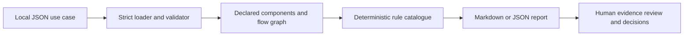

# AI Risk & Governance Lab

A lightweight Python tool for examining a proposed AI deployment before an organization relies on it. It connects a declared system model to candidate security risks, evidence requests, and decisions that remain with a human reviewer.

Organizations face risks from deploying AI poorly and from failing to use it effectively. This lab examines both: what could go wrong, what business value is expected, and what evidence would justify a controlled pilot.

**Status:** initial MVP, prepared on `feat/assessment-cli` for the first pull request. Repository access and the Apache-2.0 license are verified; hosted CI verification is pending. This is an educational assessment aid with five rules, not a comprehensive risk assessment, legal opinion, certification, or deployment approval system.

## Try it

Use Python 3.11 or later. The runtime and tests use only the standard library. No API key, model download, database, or container is required.

```sh
cd ai-risk-governance-lab
python3 -m ai_risk_lab assess examples/support-assistant.json
python3 -m ai_risk_lab assess examples/support-assistant.json --format json
python3 -m unittest discover -s tests -v
```

On macOS, check `python3 --version` first. Install a supported Python if the command is missing or older than 3.11. An optional isolated environment is `python3 -m venv .venv`, followed by `source .venv/bin/activate`. Running from this checkout needs no package installation. Optional `python3 -m pip install -e .` provides the `ai-risk-lab` command and may download build tooling.

To save a new report, add `--output assessment.md`. Existing files are never overwritten. Generated reports can contain everything in the input; keep real assessments outside version control. Only synthetic examples belong in this repository.

See the [sample report](examples/support-assistant.assessment.md), [input format](docs/input-format.md), and [assessment method](docs/assessment-method.md).

## What the first milestone demonstrates

- Strict input validation catches misspelled fields, missing endpoints, duplicate IDs, and ambiguous JSON.
- A directed graph models data flow. Cross-zone edges identify declared trust boundaries; reachable paths identify candidate prompt-injection and tool-action scenarios.
- Five deterministic rules produce traceable facts, a review priority, proposed safeguards, evidence requests, and selected framework references.
- Markdown and JSON reports preserve uncertainty: scenarios are hypotheses, control statuses are claims, and residual risk is not assessed.
- Business-value questions compare a pilot with the manual baseline, including the costs and consequences of delay.

The tool makes no network requests, executes no supplied commands, and does not open evidence references. An empty finding list still requires review.

## Architecture



The data model is a plain Python dictionary. Keeping it small makes the reasoning easier to inspect. A database or LLM would introduce operational and evaluation work before it improves this first capability. See [architecture](docs/architecture.md) and [decisions](DECISIONS.md).

## Scope and limits

The initial catalogue covers untrusted content reaching a model, sensitive data crossing a trust boundary, model-connected tools, unreliable model output, and consequential decisions. It cannot discover omitted architecture, prove exploitability, validate safeguards, estimate loss, or determine legal obligations. Trust-zone names do not prove vendor ownership or identity isolation. Reference mappings indicate conceptual relevance, not complete framework coverage or compliance.

Selected primary sources have been checked: NIST AI RMF 1.0 and CSF 2.0 function sections, OWASP LLM 2025 headings/introductions, MITRE ATLAS's Data README, ISO/IEC 42001 public metadata, and OWASP agentic publication metadata. The full ISO standard and detailed ATLAS/agentic mappings were not reviewed. The MVP explicitly pins OWASP references to 2025; a newer 2026 edition requires a separate migration review. [Research notes](docs/research.md) record exact sources and limits. Local mappings remain provisional. Framework text and datasets are not bundled.

## Develop and contribute

```text
ai_risk_lab/    validation, graph rules, CLI, report rendering
tests/          independent behavioral and CLI tests
examples/       synthetic use case and reproducible report
docs/           architecture, method, research, threat model, backlog
```

Use small branches and pull requests for substantive changes. Explain the trigger, expected behavior, uncertainty, and validation. Add a behavioral test for a new risk rule, including a case where it must not trigger. Never commit real tickets, credentials, or organizational evidence. See [contribution guidance](CONTRIBUTING.md).

Project continuity lives in [PROJECT_STATUS.md](PROJECT_STATUS.md), [ROADMAP.md](ROADMAP.md), [DECISIONS.md](DECISIONS.md), and [LEARNING_LOG.md](LEARNING_LOG.md). [The publication-ready backlog](docs/backlog.md) will become GitHub Issues after repository access is established.

## License

Licensed under [Apache-2.0](LICENSE), approved by the project owner on 2026-11-16. The license permits reuse under its terms and includes an express patent grant. Referenced standards and upstream projects retain their own terms.
