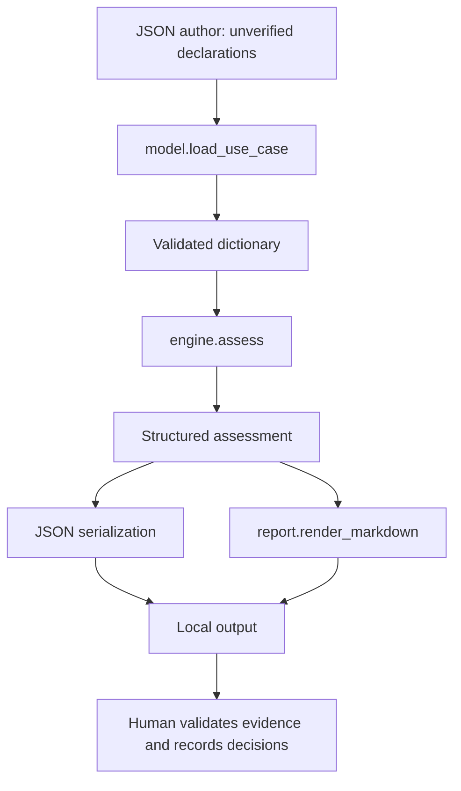

# Architecture and project charter

## Objective

Help an organization describe an AI use case, identify plausible risks, and request evidence before a human decides how to proceed. Develop technical judgment through code that is small enough to inspect and change. The artifact must demonstrate security reasoning and governance practice alongside working software.

## Project selection

Qualitative judgments below reflect this first milestone, not benchmark measurements. Higher is better; feasibility includes an 8 GB Mac and a learner maintaining the project.

| Concept | Technical depth | Practical usefulness | Portfolio value | Learning | Feasibility |
| --- | --- | --- | --- | --- | --- |
| Deployment assessment CLI | High: validation, graph traversal, rule engine, evaluation | High if assumptions are visible | High when reports are traceable | Broad security and governance integration | High; no service dependencies |
| Adversarial evaluation harness | High: attack generation, target adapters, measurements | High for a specific deployed target | High with reviewed evaluation results | Deep testing, narrower governance exposure | Medium; needs a target, evaluation design, and often API/model resources |
| Governance evidence tracker | Medium: records, evidence workflow, audit trail | High for coordination | Medium without a richer technical capability | Strong accountability and organizational process | High; risks becoming a document CRUD application |

Choose the assessment CLI. It supports a useful demonstration without pretending to solve automated approval. Use existing test harnesses later rather than recreating them. Evidence tracking can grow from report findings after the first reasoning model has been evaluated.

## MVP requirements and acceptance

| Requirement | Acceptance evidence |
| --- | --- |
| Describe purpose, value, owner, components, and flows | Synthetic example validates and appears in both output formats |
| Reject ambiguous or invalid input | Negative schema and CLI tests; duplicate JSON keys cannot silently overwrite facts |
| Identify declared boundaries and plausible risk categories | Hand-authored positive and negative baseline cases |
| Explain each finding | Rule ID, triggering declarations, representative path where applicable, evidence requests, references |
| Preserve accountability | Every report requires human review; no empty-result approval or automatic residual-risk acceptance |
| Remain light and inspectable | Standard library at runtime, local files, documented commands |
| Support future sessions | Status, decisions, roadmap, learning log, and backlog committed |

## Modules and data flow

`cli.py` parses commands, invokes the loader and engine, and writes a report. `model.py` loads bounded JSON and returns a normalized copy after structural validation. `engine.py` builds an adjacency list—a dictionary of component IDs and their outgoing connections—and applies five rules. `report.py` formats user-controlled text with HTML and Markdown escaping. JSON preserves structured output for later analysis.

Breadth-first search follows directed flows and keeps a visited set. The visited set prevents an endless loop when the graph contains a cycle. Input ordering breaks ties between equal-length paths. Each finding groups a risk category, rather than claiming to enumerate all attack paths. The first path shown is representative.

## Assumptions and trade-offs

- A validated description can still be wrong or incomplete. Structural correctness is different from factual correctness.
- Different trust-zone labels identify boundaries; they do not establish ownership, authorization, or vendor relationships.
- A data-flow path suggests a scenario worth reviewing, not executable authority or a verified attack chain.
- Rules live in Python so contributors can follow their conditions and write tests. A policy language or external catalogue would introduce complexity before the rule model stabilizes.
- Priorities are explicit review heuristics. Numerical scores would imply precision unsupported by the available evidence.
- Plain dictionaries avoid a dependency and remain familiar to new Python learners. The engine API expects the validated format; external callers should validate first.
- CLI output is a point-in-time artifact. No persistence layer, case lifecycle, or human approval record is implemented yet.

## Out of scope for this milestone

Live discovery, active security testing, LLM calls, agent autonomy, jurisdiction-specific legal determinations, vulnerability confirmation, comprehensive framework coverage, automatic approval, and production incident management.

Before adding agent assistance, establish reviewed baselines and decide how evidence provenance and action permissions will be enforced. The deterministic engine should remain usable without an agent.
